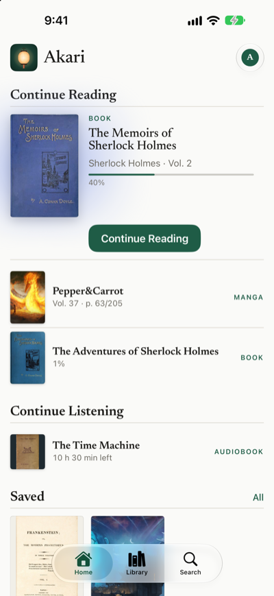
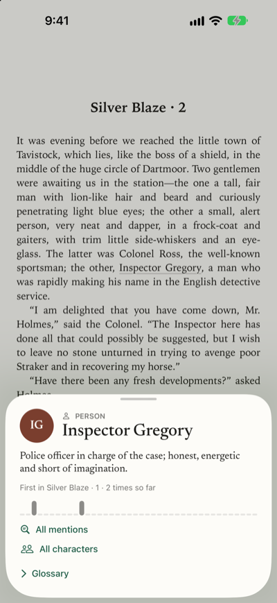
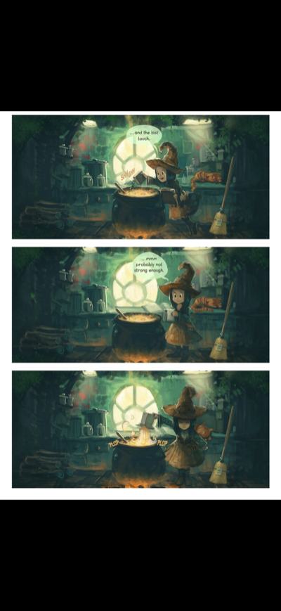
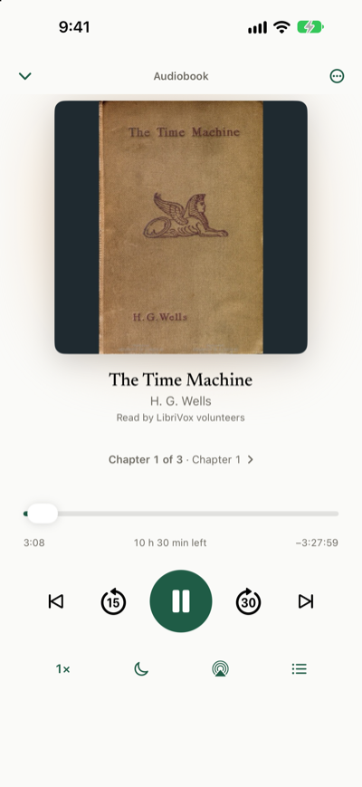
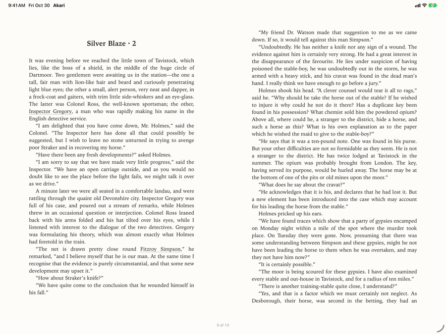
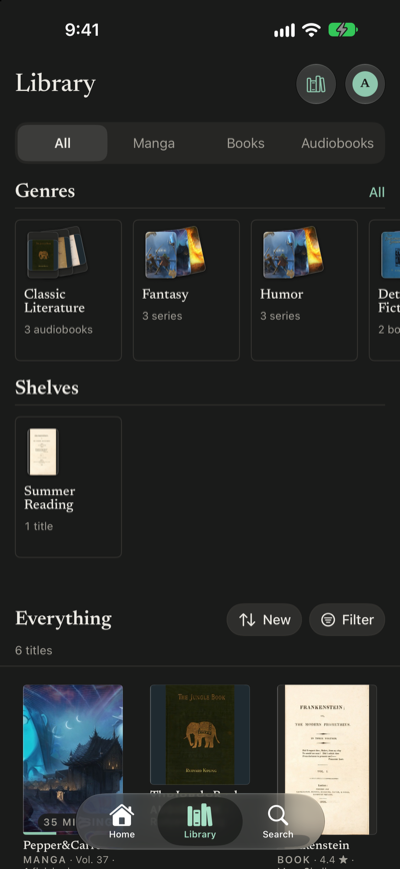
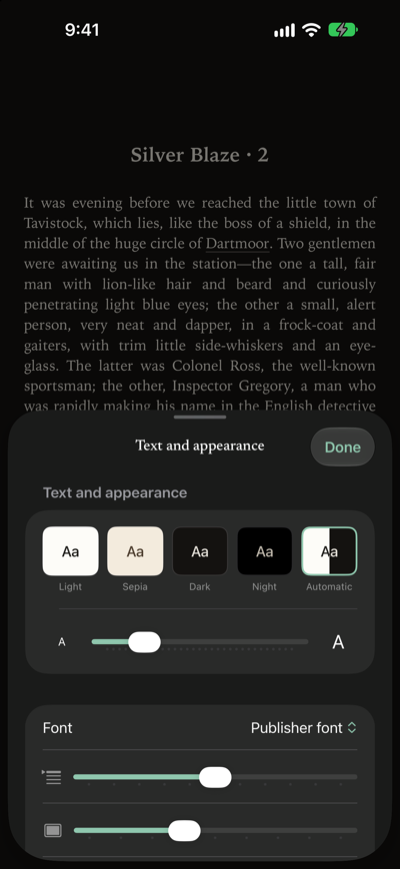
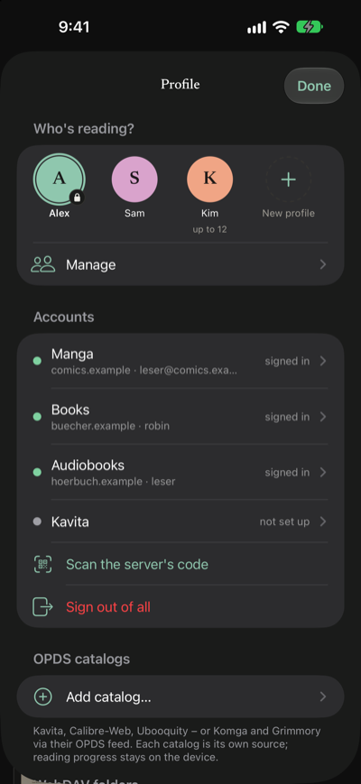

<p align="center">
  
</p>

<h1 align="center">Akari</h1>

<p align="center">
  One app for the books, comics and audiobooks on your own servers.<br>
  Komga · Kavita · Grimmory · Audiobookshelf · OPDS · WebDAV
</p>

<p align="center">
  
  
  
  
</p>

<p align="center">
  
  
  
  
</p>
<p align="center">
  
</p>
<p align="center">
  
  
  
  
</p>

## Why Akari?

If you host your own media, you usually end up with one app per server: one for manga, one for e-books, one for audiobooks, each with its own login and its own idea of where you stopped. Akari puts them in one library. It reads straight from your servers without downloading first, and it keeps your reading position on the server, so page 112 on the iPhone is page 112 on the iPad and in the server's web interface.

## Download

Akari is not on the App Store yet. Until then you can build it yourself (see [Building](#building)).

## Features

- **Six kinds of sources:** Komga, Kavita, Grimmory, Audiobookshelf, any OPDS catalog and WebDAV folders such as Nextcloud. Several servers at once, searched together.
- **Read without downloading.** Comic pages stream page by page, books open in a moment, audiobooks stream. Download a title only when you want it offline.
- **Your server keeps the reading position.** Progress syncs in both directions. If two devices disagree, the further position wins, and going backwards is never applied silently.
- **A reader for each medium:** an EPUB reader with themes, fonts and pinch-to-zoom text, a comic reader with a vertical webtoon mode, and an audiobook player that keeps playing in a mini player while you browse.
- **A glossary inside the book.** Characters and places from the book's own glossary are underlined in the text. Tap one to see who or what it is, where it first appeared and every other mention, without leaving the page.
- **Made for iPad as well:** two-page spreads in landscape for books and comics, and a layout that uses the larger screen.
- **Profiles for shared devices.** Each person gets their own server accounts, saved lists, reading statistics and appearance, optionally protected by a PIN.
- **iCloud sync** for profiles and saved lists across your own devices.
- **Reading statistics** by week, month and year, split into books, comics and audiobooks.
- **Widgets** for continuing to read or listen from the home screen.
- **Quick setup:** finds servers on your home network and can import a setup code by camera.
- **iPhone and iPad**, light and dark appearance, in English, German and Turkish.
- **A sample shelf** with public-domain books, the free comic *Pepper&Carrot* and a LibriVox recording, so you can try everything before connecting a server.

## FAQ

### Which servers does Akari support?

Komga, Kavita, Grimmory, Audiobookshelf, any OPDS catalog and WebDAV folders such as Nextcloud. You can add several servers at once, and Akari searches them together.

### How is Akari different from other comic or audiobook apps?

Most apps cover one kind of media or one kind of server. Akari reads books, comics and audiobooks from all of these servers in one library, with one reading position per title that is kept on the server.

### Do I have to download books before reading?

No. Comic pages stream page by page, books open directly and audiobooks stream. Downloading is only needed for reading offline.

### Does my reading position sync with Komga, Kavita or Audiobookshelf?

Yes. Progress syncs in both directions, so the page you reached on the iPhone is the page shown on the iPad and in the server's web interface. If two devices disagree, the further position wins.

### Can I try Akari without a server?

Yes. A sample shelf with public-domain books, the free comic *Pepper&Carrot* and a LibriVox audiobook is built in.

### Does Akari work on the iPad?

Yes, with two-page spreads in landscape for books and comics. Akari runs on iPhone and iPad; there is no Android version.

### Does Akari send my data anywhere?

Only to the servers you add. There is no analytics, no tracking and no account with us. See [Privacy](#privacy).

## Requirements

| | |
|---|---|
| Xcode | 27 or later |
| iOS / iPadOS | 26.0 or later |
| [XcodeGen](https://github.com/yonaskolb/XcodeGen) | 2.46 or later |
| A server | Komga, Kavita, Grimmory, Audiobookshelf, an OPDS catalog or a WebDAV share |

## Building

The Xcode project is generated from `project.yml` and is not checked in.

```sh
git clone https://github.com/ms-solutions-dev/akari.git
cd akari
xcodegen generate
open Akari.xcodeproj
```

Choose the `Akari` scheme and run it on a simulator. Launch with the argument `-attrappen` to use built-in sample data instead of real servers.

To run it on your own devices, set your development team and change the bundle identifiers (`dev.ms-solutions.akari…`), the app group and the iCloud container in `project.yml`. The CloudKit schema for your own container is in `cloudkit/schema.ckdb`.

Each package under `Packages/` has its own tests:

```sh
swift test --package-path Packages/SourcesKit
```

## Project layout

| Path | Contents |
|---|---|
| `App/`, `Widget/` | App and widget targets |
| `Packages/Features` | Screens and navigation |
| `Packages/SourcesKit` | Common model for titles, series and reading state; the source protocol |
| `Packages/KomgaKit`, `KavitaKit`, `GrimmoryKit`, `AudiobookshelfKit`, `OpdsKit`, `WebdavKit` | One adapter per server type |
| `Packages/Library` | The combined library across all sources |
| `Packages/ReadingProgress` | Reading position sync and conflict handling |
| `Packages/OfflineStore` | Downloads and cache |
| `Packages/AccountsKit` | Profiles, accounts and keychain storage |
| `Packages/BookReader`, `ComicReader`, `AudioPlayer` | The three readers |
| `Packages/Bedrock` | Shared foundation: networking, certificates, iCloud sync |
| `Packages/DesignSystem` | Colours, type and shared components |
| `UITests/`, `UIFlow/` | Screenshot and scrolling performance tests |

## Privacy

Akari talks only to the servers you add. There is no analytics, no tracking and no account with us. Profiles and saved lists sync through your private iCloud database; server passwords stay in the keychain on your device.

## Contributing

Bug reports and pull requests are welcome, see [CONTRIBUTING.md](CONTRIBUTING.md). Before your first pull request is merged, you sign our [Contributor License Agreement](CLA.md) with a one-line comment. You keep the copyright in your work.

**Translations:** all user-facing text lives in the string catalogs (`*.xcstrings`). Adding a language is a good first contribution.

## Credits

- [Readium Swift Toolkit](https://github.com/readium/swift-toolkit) for the EPUB reader
- [Newsreader](https://github.com/productiontype/Newsreader) typeface, SIL Open Font License 1.1
- [Pepper&Carrot](https://www.peppercarrot.com) by David Revoy, CC BY 4.0, in the sample shelf and sample data
- Sample data: public-domain cover scans from Wikimedia Commons and Gallica, texts by Arthur Conan Doyle, Theodor Storm, Gottfried Keller and Annette von Droste-Hülshoff, an excerpt of *The Time Machine* read by LibriVox volunteers; sources and licenses are listed next to the files in [`SampleCovers/LICENSES.md`](Packages/Features/Sources/Features/SampleCovers/LICENSES.md), [`MockContent/LICENSES.md`](Packages/Features/Sources/Features/MockContent/LICENSES.md) and [`Beispiele/LICENSES.md`](Packages/Features/Sources/Features/Beispiele/LICENSES.md)
- Further packages: CryptoSwift, DifferenceKit, Fuzi, GCDWebServer, SQLite.swift, SwiftSoup, Zip, ZIPFoundation. Licenses are listed in the app under *About*.

## License

Copyright © 2026 ms-solutions

Akari is free software: you can redistribute it and/or modify it under the terms of the GNU General Public License as published by the Free Software Foundation, either version 3 of the License, or (at your option) any later version. See [LICENSE](LICENSE).
